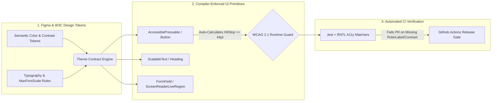

# React Native Compiler-Enforced Accessibility (WCAG 2.1 AA) Design System

[](https://www.typescriptlang.org/)
[](https://expo.dev/)
[](#compiler-enforced-accessibility-contracts)
[](#automated-accessibility-quality-gates)

An enterprise-grade **Universal Design System blueprint** for React Native (iOS, Android, Tablet, Web) that shifts **WCAG 2.1 Level AA accessibility compliance** left—from manual QA audits directly into the **TypeScript compiler** and **automated CI unit test gates**.

Engineered for large multi-team mobile organizations across Healthcare, PropTech, and FinTech where regulatory accessibility compliance (ADA / Section 508 / WCAG 2.1) and cross-platform consistency are mandatory.

Designed and maintained by **[Julian Khatibi](https://www.khatibi.app/)**.

---

## The Architectural Problem

In enterprise mobile engineering organizations with 20–100+ developers shipping features concurrently, design systems typically fail in three areas:
1. **Accessibility Regressions in Production:** Developers ship icon-only buttons or custom touchables without `accessibilityLabel`, `accessibilityRole`, or `accessibilityState`, breaking iOS VoiceOver and Android TalkBack for visually impaired users.
2. **Dynamic Type Layout Breakage:** When users enable OS-level large accessibility font sizes (200%+ scaling), fixed-height cards and horizontal rows clip text or push action buttons off-screen.
3. **Sub-44pt Touch Targets:** Compact UI elements violate Apple HIG (44x44pt) and Material Design (48x48dp) minimum hit-target guidelines, degrading usability for users with motor impairments.

---

## System Architecture & Token Pipeline



---

## Key Engineering Highlights

### 1. Compiler-Enforced Accessibility Contracts
Instead of treating accessibility props as optional React Native `ViewProps`, core interactive primitives use **TypeScript Discriminated Unions**:
- TypeScript **requires** an explicit `accessibilityLabel` for individually accessible controls; a runtime guard rejects empty or whitespace-only labels (TypeScript cannot prove an arbitrary string is non-empty).
- Controls aggregated by a parent may explicitly opt out with `accessible={false}`. Checkbox, switch, and radio roles require `isChecked`; checkboxes also support `"mixed"`.
- Interactive elements enforce explicit `accessibilityRole` (`button`, `link`, `switch`, `tab`) and automatically map `disabled` and `loading` states into `accessibilityState={{ disabled, busy }}`.

### 2. Automatic 44x44pt Touch Target Expansion (`HitSlop` Engine)
Compact UI controls (such as 24x24px close icons or inline filter pills) automatically compute and apply native `hitSlop` insets at render time so the physical touch area always meets the **WCAG 2.5.5 / Apple HIG 44x44pt** minimum without altering visual layout spacing.

The 44pt target is an additional design-system policy: WCAG 2.1 criterion 2.5.5 is **AAA**, not AA. Insets merge with caller-provided hit slop and update after layout measurement. Native hit areas cannot extend beyond parent bounds or displace overlapping siblings; reserve sufficient layout space using `minimumTouchTarget` and verify on devices. Android's recommended 48dp target is exported separately.

### 3. Dynamic Type Guardrails (`maxFontSizeMultiplier`)
Typography primitives categorize text into semantic tiers (`body`, `caption`, `hero`, `compactNav`) with calibrated `maxFontSizeMultiplier` ceilings and automatic flex-wrap fallbacks—preventing layout truncation under maximum OS accessibility text scaling.

`ScalableText` requires a `tier`. Body/caption allow up to 3× scaling; hero/compact navigation allow 2×. An optional `maxFontSizeMultiplier` of 2, 2.5, or 3 is clamped to the tier ceiling. Scaling cannot be disabled and line-count truncation/shrink-to-fit are excluded from the public contract. Avoid fixed-height containers and restrictive style overrides; wrapping and actual content reflow still require integration testing.

`LiveAnnouncement` accepts `message`, optional `politeness` (`polite` by default), and `visuallyHidden` (true by default). Keep it mounted and update the message for meaningful state changes. Android/react-native-web use a native live region; iOS queues polite VoiceOver announcements and interrupts for assertive updates. Identical messages do not reannounce until changed. Assertive announcements should be reserved for urgent events.

---

## Project Structure

```text
rn-universal-a11y-design-system/
├── src/
│   ├── primitives/
│   │   ├── AccessiblePressable.tsx       # Type-enforced WCAG 2.1 interactive primitive
│   │   ├── ScalableText.tsx              # Dynamic Type-safe typography component
│   │   └── LiveAnnouncement.tsx          # Polite/Assertive screen-reader announcements
│   ├── tokens/
│   │   ├── colors.ts                     # WCAG AA/AAA contrast-verified semantic palette
│   │   └── spacing.ts                    # 4pt spatial grid & minimum touch target constants
│   └── testing/
│       └── expectAccessibleElement.ts    # Custom Jest/RNTL accessibility assertion helper
├── __tests__/
│   └── AccessiblePressable.test.tsx      # Automated VoiceOver/TalkBack semantics test suite
└── README.md
```

---

## Automated Accessibility Quality Gates

Every UI primitive is validated in CI using **Jest** and **React Native Testing Library (`@testing-library/react-native`)**:
- Verifies that interactive components resolve an accessible name (`getByRole('button', { name: ... })`).
- Asserts that `busy` / `disabled` / `checked` states propagate accurately to the native accessibility tree.
- Verifies foreground/background token pairs maintain a minimum **4.5:1 contrast ratio** (normal text) and **3.0:1** (large text / UI components).

---

## Development and Consumption

Use Node.js 22.11+ and npm:

```sh
npm ci
npm run typecheck
npm run lint
npm test
npm run build
```

React 19.1 and React Native 0.81 are peer dependencies. The root entry exports primitives and tokens; test-only helpers must be imported separately from `rn-universal-a11y-design-system/testing` in Jest, never in application code. The helper uses RNTL's built-in matchers and accepts an element plus its expected role, accessible name, and optional accessibility state.

`colors.light` and `colors.dark` provide opaque semantic palettes. `contrastPairs` specifies the **only guaranteed foreground/background combinations** and their AA/AAA normal-text thresholds; contrast is verified without rounding in CI. Do not assume arbitrary token combinations, opacity changes, or gradients preserve contrast. The palette does not automatically follow the OS theme; choose tokens explicitly in application styles.

Compiler contracts and regression tests reduce accessibility defects but do not certify WCAG compliance. Audit VoiceOver, TalkBack, keyboard/focus behavior, text reflow, parent clipping, and actual rendered colors on every supported platform.

---

## Author

**Julian Khatibi**  
Staff / Lead Mobile Architect (React Native, TypeScript, iOS/Android)  
[Portfolio (khatibi.app)](https://www.khatibi.app/) • [LinkedIn](https://www.linkedin.com/in/ajkhatibi/) • [Medium](https://medium.com/@ajkhatibi)
